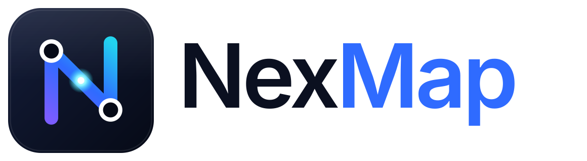
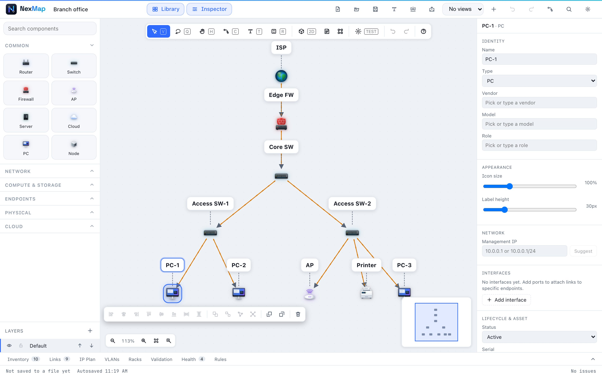
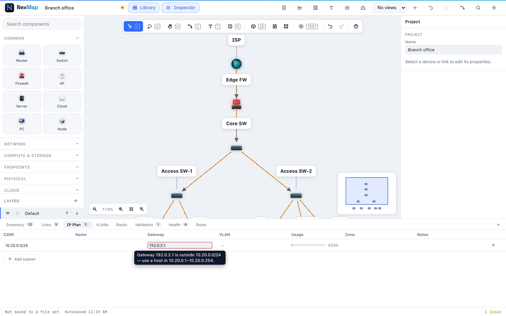
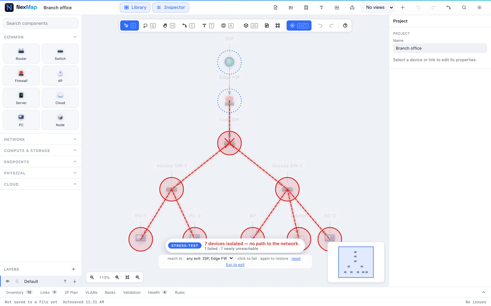
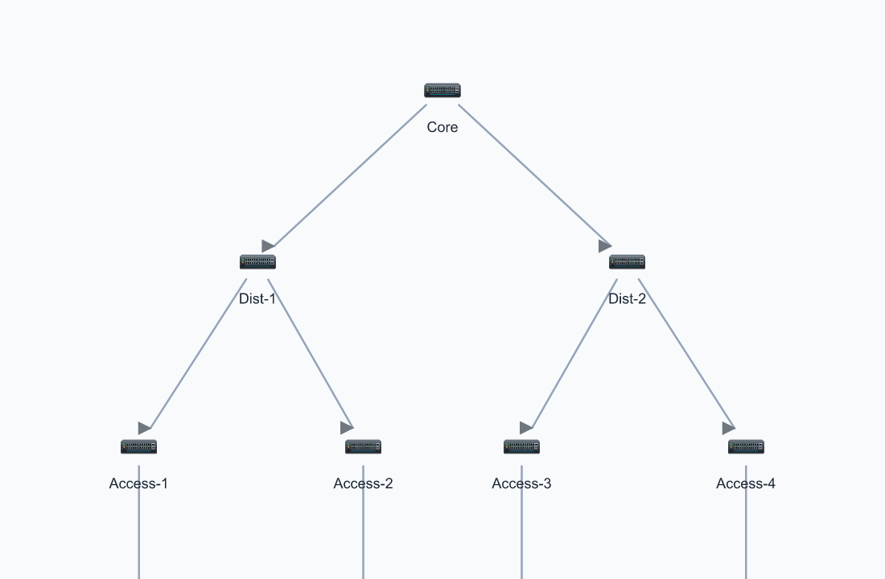
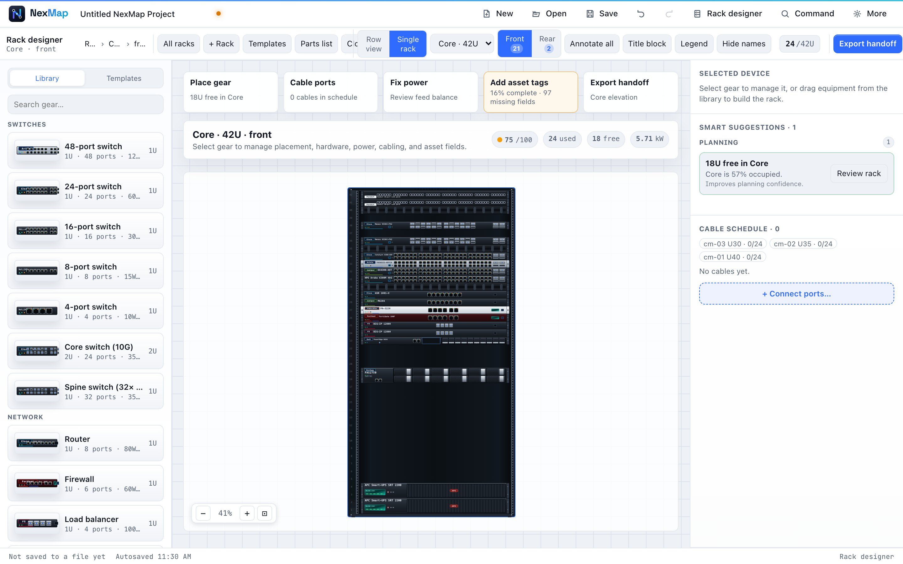

<p align="center">
  <a href="https://nexmap.xyz/">
    <picture>
      <source media="(prefers-color-scheme: dark)" srcset="docs/brand/nexmap-lockup-dark.svg">
      
    </picture>
  </a>
</p>

<h3 align="center">Draw your network. NexMap checks it while you draw.</h3>

<p align="center">
  A free network and server-rack designer that runs in your web browser.<br>
  No sign-up, no install, and your work never leaves your computer.
</p>

<p align="center">
  <a href="https://nexmap.xyz/"><b>▶ Open NexMap</b></a> ·
  <a href="docs/guide/getting-started.md">Getting started</a> ·
  <a href="docs/README.md">User guide</a> ·
  <a href="docs/guide/faq.md">FAQ</a>
</p>

<p align="center">
  <a href="https://nexmap.xyz/"></a>
  <a href="LICENSE"></a>
  
  
</p>

<p align="center">
  
</p>

## What is NexMap?

NexMap is like a drawing app made for networks. You drag in routers,
switches, Wi-Fi access points, computers and servers, connect them with
lines, and you have a clear picture of how everything is wired together.

What makes it different is that **NexMap understands what you draw**. As you
work, it quietly checks your design and points out real problems, such as two
devices sharing the same address, a network that has no way out to the
internet, or a single cable that would take everything down if it failed. You
don't need to know what to look for; NexMap tells you, and usually offers to
fix it.

It can also plan the **physical** side: which shelf of a server rack each box
goes in, which port each cable plugs into, and whether the power supply can
take the load.

## Who is it for?

- **Anyone setting up a home or small-office network** who wants to see it
  clearly and get it right the first time.
- **IT staff and network engineers** documenting real infrastructure, from a
  branch office to a data center.
- **Students and teachers** learning how networks fit together.
- **Consultants and installers** who need a clean diagram, an installation
  sheet and a parts list to hand over.

## Try it in three steps

1. **Open [nexmap.xyz](https://nexmap.xyz/)** in any modern browser and choose
   **Network Designer**.
2. **Pick a starting point**: a blank page, or one of 18 ready-made examples such as
   *Home Wi-Fi*, *Small office* or *Three-tier campus*.
3. **Drag, connect and fix.** Drag devices from the library on the left,
   connect them, and watch the **Validation** tab at the bottom tell you what
   needs attention.

That's it: no account, nothing to install. NexMap saves your work in your
browser as you go, and you can save a copy to your computer at any time.

➡️ The **[Getting started guide](docs/guide/getting-started.md)** walks
through your first diagram with pictures.

## A quick tour

### It checks your work as you draw

Mistakes show up in the **Validation** tab as you make them. Click one and
NexMap takes you straight to the field that needs fixing, explains what's
wrong, and suggests the right value. Many problems can be fixed in one click.

<p align="center">
  
</p>

### Stress-test it: what if something breaks?

Turn on **Stress-test** and click any device to "unplug" it. NexMap shows
instantly what loses its connection, and what keeps working through a
backup path. Click it again to plug it back in.

<p align="center">
  
</p>

### See it flat or in 3D

Switch between a clean flat diagram and a 3D (isometric) view with one
click: same design, two ways to present it.

<p align="center">
  
</p>

### Plan the server rack too

The **Rack Designer** shows real-looking equipment in real racks. Mount gear
at any height, plug cables port to port, check that power and space add up,
and export an installation packet for whoever does the work.

<p align="center">
  
</p>

### Bring your data in, take results out

- **Import** spreadsheets (CSV), diagrams from draw.io and GraphML, network
  scans (Nmap) and NetBox exports.
- **Export** a picture (PNG, JPG, SVG), a PDF, an interactive web page, device
  and cable lists (CSV), or a complete ZIP handoff package.

## Your data stays yours

NexMap is built to be private by design:

- **No account, no login, no tracking.**
- **Nothing is uploaded.** Your designs are saved in your browser and in files
  on your own computer. The app even blocks itself from sending data anywhere.
- **Works offline.** After your first visit, NexMap opens and works without an
  internet connection.
- **Free and open source** under the [MIT license](LICENSE).

> [!TIP]
> Browser storage can be wiped if you clear your browsing data. For anything
> you care about, use **Save** to keep a `.nexmap` file on your computer.

## Learn more

| | |
| --- | --- |
| 🚀 [Getting started](docs/guide/getting-started.md) | Your first diagram, step by step |
| 🗺️ [The Network Designer](docs/guide/network-designer.md) | Every part of the screen, explained |
| ✅ [Checking your design](docs/guide/checking-your-design.md) | Validation, health, rules and stress-testing |
| 🗄️ [The Rack Designer](docs/guide/rack-designer.md) | Racks, gear, cables and power |
| 🔁 [Import and export](docs/guide/import-export.md) | Every file type NexMap reads and writes |
| 💾 [Saving, privacy and offline](docs/guide/saving-and-privacy.md) | Where your work lives and how to keep it safe |
| ⌨️ [Keyboard shortcuts](docs/guide/shortcuts.md) | Work faster |
| 📖 [Glossary](docs/guide/glossary.md) | Networking words in plain English |
| ❓ [FAQ](docs/guide/faq.md) | Quick answers |

## For developers

NexMap is a React + TypeScript app with no backend. To run it locally:

```bash
npm install
npm run dev
```

Then open the address it prints (usually http://localhost:5173).
**[DEVELOPING.md](docs/DEVELOPING.md)** covers the architecture, tests,
deployment and project layout, and **[CONTRIBUTING.md](CONTRIBUTING.md)** explains how to
send a change. The file format is documented in
[`docs/FORMAT.md`](docs/FORMAT.md).

## Project status

NexMap is under active development and hasn't reached version 1.0 yet. It's
already usable for real work, but expect some rough edges, and the file format
may still change (older files are always upgraded when opened). Found a
problem or have an idea? [Open an issue](https://github.com/pateldev2511/NexMap/issues).
See [SECURITY.md](SECURITY.md) to report a security problem privately.

## License

[MIT](LICENSE) © 2026 Dev
