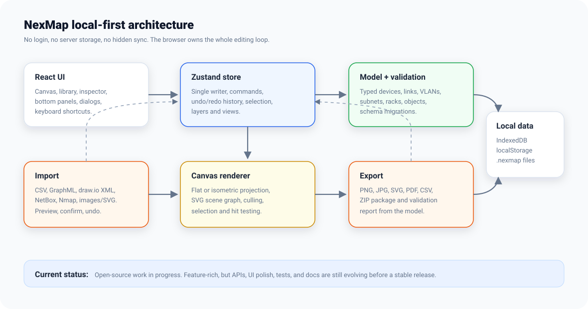
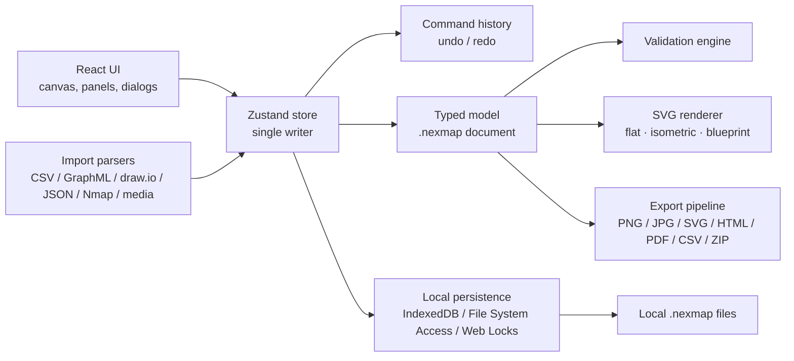

# Developing NexMap

NexMap is a single-page app: React 18 and TypeScript, built with Vite, with
no backend. Everything runs in the browser. Project data lives in IndexedDB
and in `.nexmap` files the user saves.

## Run it

Requires **Node 22+**.

```bash
npm install
npm run dev
```

Open the address Vite prints (usually http://localhost:5173). If the port is
busy, Vite picks the next free one.

## Scripts

| Command | What it does |
| --- | --- |
| `npm run dev` | Development server with hot reload |
| `npm run build` | Type-check and build to `dist/` |
| `npm run preview` | Serve the production build locally |
| `npm test` | Unit tests (Vitest) |
| `npm run lint` | ESLint |
| `npm run typecheck` | TypeScript project check |
| `npm run e2e` | Browser tests (Playwright) against the dev server |
| `npm run e2e:preview` | Browser tests against the **production build**: offline support and the service worker |
| `npm run e2e:install` | Install the Playwright browser once |
| `npm run gen:readme-media` | Regenerate `docs/assets/nexmap-*.svg` and the flat ↔ 3D GIF from the export pipeline |
| `npm run docs:screenshots` | Regenerate the guide's screenshots from the running dev server |
| `python3 scripts/brand-export.py` | Regenerate the logo files, icons and link preview ([brand guide](brand/README.md#regenerating)) |
| `npm run deploy:check` | Build and validate the Cloudflare config without deploying |

> [!NOTE]
> The dev server turns off the Content-Security-Policy and the network
> tripwire so hot reload works, and it doesn't register the service worker.
> To see the real local-first enforcement and offline behaviour, use
> `npm run build && npm run preview`, and test with `npm run e2e:preview`.

## Before you open a pull request

CI runs these; all must pass:

```bash
npm run lint && npm test && npm run build && npm run e2e && npm run e2e:preview
```

Also run `npm audit --omit=dev`: CI fails on high or critical advisories in
what ships to users.

## Architecture





- **One model, one writer.** Every change goes through the Zustand store
  (`src/store/projectStore.ts`) as a command, so undo/redo is exact and
  autosave sees every edit. Each change bumps a document revision; a save
  marks clean only the revision it wrote.
- **Rendering is SVG**, from the same model in three projections (flat,
  isometric, blueprint). Exports reuse the on-screen renderer, so what you see
  is what you export.
- **Validation is pure** (`src/model/validate.ts`): the model in, findings
  out. The editor and every exported report share it.
- **Persistence** (`src/persistence/`): IndexedDB drafts (debounced, flushed
  when the tab hides), File System Access save/open with a download fallback,
  and Web Locks so a second tab is view-only.
- **Offline:** `public/sw.js` precaches every file of the build (the list is
  injected at build time by `swPrecachePlugin` in `vite.config.ts`). Pages load
  network-first, hashed assets cache-first.
- **Both designers and every dialog are lazy chunks**, prefetched once the
  launch screen paints; `scripts/measure-load.mjs` measures load time on a
  throttled phone profile.

## Local-first guarantee

NexMap must never send project data anywhere. Two layers enforce it in
production: a strict Content-Security-Policy (`src/lib/csp.ts`, injected at
build time) and a runtime tripwire (`src/lib/netguard.ts`) that throws on any
request to another origin. See [CONTRIBUTING.md](../CONTRIBUTING.md#the-local-first-invariant-non-negotiable).

## Project layout

```text
src/
  model/        types, schema, migrations, validation, rules
  store/        the Zustand store and command history
  canvas/       SVG canvas, projections, gestures, toolbar, device art
  rack/         the Rack Designer: faceplates, power, cabling, exports
  sim/          the stress-test (blast radius) and uplink simulation
  io/           import parsers and export pipeline
  persistence/  drafts, files, Web Locks, recovery
  input/        the keyboard router and pointer gesture machine
  lib/          IP/CIDR, CSV, geometry, layout, health, prefs
  ui/           shell, panels, inspector, dialogs, launch screen
e2e/            Playwright tests (dev server)
e2e-preview/    Playwright tests (production build)
scripts/        documentation media, screenshots, brand export, load measurement
docs/           user guide, file format, brand, catalog sources
public/         icons, manifest, service worker, link preview
```

## Deploying

NexMap builds to static files, so it hosts anywhere that serves them. The live
site at [nexmap.xyz](https://nexmap.xyz/) is a Cloudflare Workers static-assets
app; pushing to `main` deploys it through Cloudflare's Git integration.

```bash
npm run deploy:check     # build + validate, no upload
npm run deploy:workers   # build + deploy to Cloudflare Workers
npm run deploy:pages     # build + deploy to Cloudflare Pages
```

Config is in `wrangler.toml` (assets only, no server code or storage). The SPA
fallback is `not_found_handling = "single-page-application"`. Caching and
security headers come from `public/_headers`.

## File format

`.nexmap` files are plain JSON. [FORMAT.md](FORMAT.md) documents the current
schema (v7), its history and the compatibility rules: older files migrate
forward, newer ones are refused rather than damaged.
