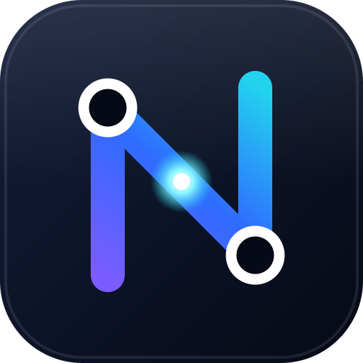

  

# NexMap documentation

## Using NexMap

Start here if you want to design a network: no technical background needed.

| Guide | What you'll learn |
| --- | --- |
| [Getting started](guide/getting-started.md) | Your first diagram, from a blank screen to a checked design |
| [The Network Designer](guide/network-designer.md) | Every button, panel and tool on the screen |
| [Checking your design](guide/checking-your-design.md) | Validation, health, rules and the stress-test |
| [The Rack Designer](guide/rack-designer.md) | Racks, equipment, cabling, power and installation handoff |
| [Import and export](guide/import-export.md) | Every file NexMap reads and writes |
| [Saving, privacy and offline](guide/saving-and-privacy.md) | Where your work lives and how to keep it safe |
| [Keyboard shortcuts](guide/shortcuts.md) | Work faster |
| [Glossary](guide/glossary.md) | Networking words in plain English |
| [FAQ](guide/faq.md) | Quick answers |

## Building NexMap

For developers and contributors.

| Document | Covers |
| --- | --- |
| [DEVELOPING.md](DEVELOPING.md) | Running it locally, tests, architecture, deployment |
| [CONTRIBUTING.md](../CONTRIBUTING.md) | How to propose a change |
| [FORMAT.md](FORMAT.md) | The `.nexmap` file format (schema v7) |
| [ICON-SYSTEM.md](ICON-SYSTEM.md) | How device icons are drawn |
| [CATALOG-DEPTHS.md](CATALOG-DEPTHS.md) · [CATALOG-UPS.md](CATALOG-UPS.md) | Where the rack catalog's numbers come from |
| [Brand](brand/README.md) | The logo, colours, and how to regenerate the assets |
| [SECURITY.md](../SECURITY.md) | Reporting vulnerabilities, dependency checks |
