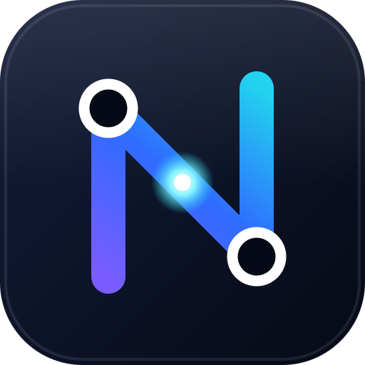

<p align="center">
  
  
</p>

# The NexMap brand

## The mark: a routed N



The logo is the letter **N** drawn as a single network cable. It runs up, across
and up again, passing through two **nodes** (the white rings), and a **signal**
glows on the link between them.

It says what NexMap does: you draw a network, and it comes alive. The cable's
colour runs from violet to blue to cyan, the same palette as the app.

In the app the mark is animated: the cable draws itself in once, and the signal
travels along the link. When a device asks for reduced motion, it stays still.

## Which file to use

| You need… | Use | Notes |
| --- | --- | --- |
| The logo with the name, on a light page | [`nexmap-lockup-light.svg`](nexmap-lockup-light.svg) | Text is outlined, so it looks the same everywhere |
| The logo with the name, on a dark page | [`nexmap-lockup-dark.svg`](nexmap-lockup-dark.svg) | |
| Just the icon | [`nexmap-mark.svg`](nexmap-mark.svg) | The master; everything else derives from it |
| A tiny icon (16–32 px) | [`nexmap-mark-small.svg`](nexmap-mark-small.svg) | Heavier cable, solid nodes, no glow: stays crisp |
| One colour (print, engraving, a stamp) | [`nexmap-mark-mono.svg`](nexmap-mark-mono.svg) | Takes the surrounding text colour |
| An app icon a phone will crop to a circle | [`nexmap-icon-maskable.svg`](nexmap-icon-maskable.svg) | Full-bleed, mark inside the safe zone |

The website's icons (`public/icon.svg`, `favicon.svg`, the PNG icons and the
`og.png` link preview) are generated from these files; see
[Regenerating](#regenerating).

## Colours

| | Hex | Used for |
| --- | --- | --- |
| Violet | `#7a5cff` | Start of the cable |
| Blue | `#2f6bff` | Middle of the cable, "Map" in the wordmark (light) |
| Cyan | `#22d3ee` | End of the cable, the signal |
| Ink | `#0b1020` | "Nex" in the wordmark (light) |
| Night | `#060a16` → `#141d3a` | The icon tile |

## Using it well

- **Leave room around it.** Keep clear space of at least the height of one node
  ring on every side.
- **Keep it big enough.** Use the full mark at 32 px and up; below that, use the
  small version.
- **Don't** recolour the cable, stretch the mark, add effects, put it on a busy
  photo, or rebuild the wordmark in another font.

## Typeface

The wordmark is set in **Inter SemiBold** (SIL Open Font License), NexMap's
interface font, and then converted to outlines.

## How it was made

The four directions we considered are in [`concepts/`](concepts/) (see
[`board.png`](concepts/board.png)). **A · Routed N** was chosen because it is
ownable (it is NexMap's own letter), it carries the app's idea, and it holds up
at favicon size.

The marks are hand-authored SVG. [VectorCraft](https://getartcraft.com/apps/vectorcraft)
(part of the ArtCraft suite) outlines the wordmark and renders every PNG.

## Regenerating

Edit the SVGs here (live-text sources are in [`src/`](src/)), then:

1. Start VectorCraft with its local control server:
   ```bash
   open -a VectorCraft --args --control 7979 --automation-read-root "$PWD" --automation-write-root "$PWD/docs/brand" --automation-write-root "$PWD/public"
   ```
2. From the repository root, run:
   ```bash
   python3 scripts/brand-export.py
   ```

It rewrites the outlined lockups, `public/icon.svg`, `public/favicon.svg`, the
PNG icons and `public/og.png` in about two seconds.
