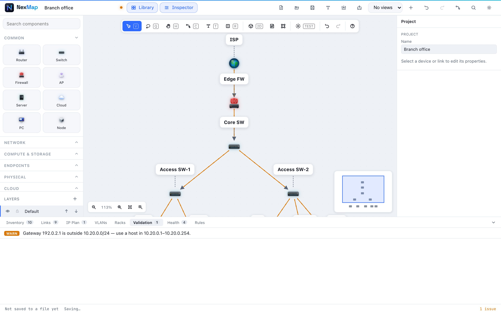
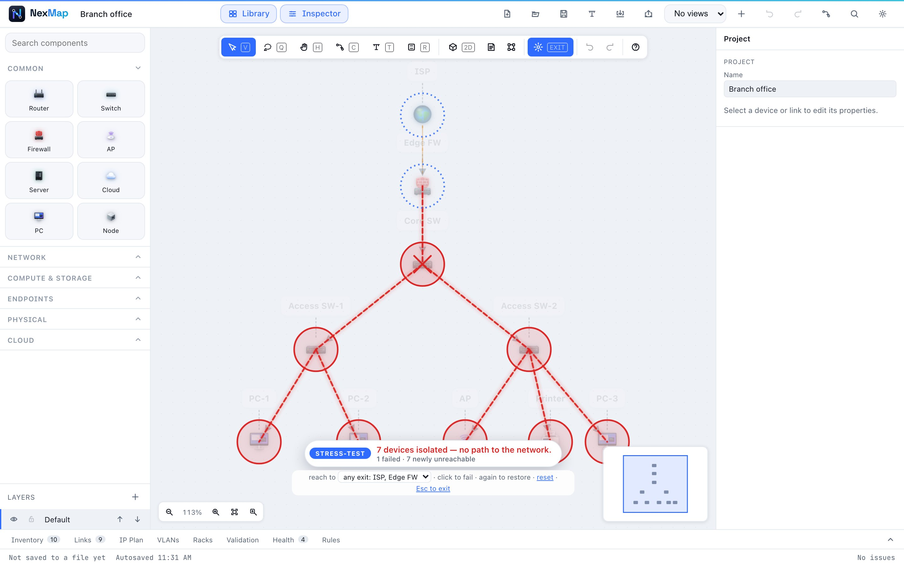

# Checking your design

NexMap doesn't just draw your network: it reads it. This page explains the
four ways it helps you get the design right:

1. **[Validation](#validation-mistakes-found-as-you-go)** catches mistakes as you make them.
2. **[Health](#health-how-resilient-is-it)** scores how well the design copes with failures.
3. **[Rules](#rules-promises-your-design-keeps)** are promises you want the design to keep.
4. **[Stress-test](#stress-test-what-if-something-breaks)** lets you break things on purpose and watch.

## Validation: mistakes found as you go

The **status bar** always shows how many issues there are. The
**Validation** tab lists them, most serious first:

- 🔴 **Errors**: something is definitely wrong and should be fixed.
- 🟠 **Warnings**: probably a mistake, or a risk worth a look.
- 🔵 **Info**: worth knowing, often fine.

  

**Click a finding** and NexMap takes you to it. For an address or subnet
problem it opens the exact field, marks it in red and explains what would
work. The mark disappears the moment it's fixed. For a device or link it
shows you the object on the canvas. Everything works from the keyboard too:
<kbd>Tab</kbd> to a finding and press <kbd>Enter</kbd>.

### One-click fixes

Many findings have a button that fixes them, such as **Name it**, **Resolve**,
**Add subnet**, **Assign** or **Prune**. When several can be fixed safely,
**Fix all safe issues** does them all at once. Each fix is a separate step
you can undo.

### What NexMap checks

**Addresses** ([what's an IP address?](glossary.md#ip-address))

| Check | What it means |
| --- | --- |
| Duplicate IP 🔴 | Two devices or ports have the same address, so neither will work reliably. NexMap knows that different spellings of the same IPv6 address are the same. |
| Invalid IP 🔴 | An address that isn't written correctly. |
| Address outside any subnet 🟠 | An address that doesn't belong to any of your [subnets](glossary.md#subnet). |

**Subnets** (the IP Plan)

| Check | What it means |
| --- | --- |
| Invalid subnet 🔴 | A subnet range that isn't written correctly (e.g. `10.0.0.0/24`). |
| Overlapping subnets 🟠 | Two subnets share addresses, which confuses routing. |
| No gateway 🟠 | The subnet has no [gateway](glossary.md#gateway), so its devices can't reach other networks. |
| Gateway not an address 🔴 / outside the subnet 🟠 / unusable 🟠 | The gateway is mistyped, belongs to a different range, or is one of the two reserved addresses. NexMap tells you which addresses would work. |
| IPv6 subnet 🔵 | IPv6 ranges are kept, but their overlaps and gateways aren't checked yet. |

**VLANs** ([what's a VLAN?](glossary.md#vlan))

| Check | What it means |
| --- | --- |
| Duplicate VLAN 🔴 | The same VLAN number is defined twice. |
| VLAN out of range 🔴 | VLAN numbers go from 1 to 4094. |
| Trunk with no VLANs 🟠 | A [trunk](glossary.md#trunk) link doesn't say which VLANs it carries. |
| Access link with several VLANs 🟠 | An access link should carry exactly one VLAN. |

**Devices and links**

| Check | What it means |
| --- | --- |
| Missing endpoint 🔴 | A link isn't connected to a device at one end. |
| Unnamed device 🟠 | A device has no name. |
| Duplicate name 🟠 | Two devices share a name, which makes the diagram ambiguous. |
| Disconnected device 🔵 | A network device has no links in the diagram. |
| Cabled but not drawn 🔵 | A device is cabled in a rack but has no link in the network diagram. |
| Passive rack assets 🔵 | One line counting the power gear, cable managers and panels that aren't expected to have network links. |
| Missing port 🟠 | A link refers to a [port](glossary.md#interface-port) that was removed. |
| Overloaded port 🟠 | Several links use the same port. |

**Racks** ([what's a rack?](glossary.md#rack))

| Check | What it means |
| --- | --- |
| Overlapping equipment 🔴 | Two devices occupy the same space in a rack. |
| Off the top 🟠 | A device sits above the top of its rack. |
| Too deep 🟠 | A device is deeper than its rack, or front and rear equipment collide. |

## Health: how resilient is it?

The **Health** tab gives the design a **Topology soundness** score out of 100.
It lists the risks that lower it:

- **Single points of failure**: a device or link whose loss would cut part of
  the network off.
- **Conflicting parallel links**: two links between the same devices that
  disagree on their settings.
- **Disconnected pieces**: parts of the design not connected to the rest.

**Path redundancy** answers *"if one cable fails, can these two still talk?"*
Pick a **From** and a **To** device and press **Check**. NexMap tells you
whether there's no path, one path (and exactly which link would separate them),
or several independent paths. The answer stays up to date as you edit.

## Rules: promises your design keeps

Rules let you state what must always be true, and NexMap checks it for you.

**Built-in rules** you can switch on in the **Rules** tab:

- No single point of failure
- Every device is addressed
- Every device is named
- Every subnet has a gateway

**Your own rules** are built from a device [role](glossary.md#role) and a
condition, for example:

- "every *access switch* **connects to at least** 2 *core switches*"
- "*guest* devices **must not reach** *servers*"
- "every *camera* **lives in** the *CCTV* VLAN"
- "there **exist** at least 2 *firewalls*"
- "every *firewall* **is named like** `FW-#`"

You can also type a rule in plain words in the command palette
(<kbd>Ctrl</kbd>+<kbd>K</kbd>), and the Rules tab suggests rules your design
already follows, so you can lock them in.

Turn on **Enforce** for a rule and NexMap undoes any edit that would break it.
Rules are saved with your project, and you can **Save rules as file** to
reuse them in other projects.

## Stress-test: what if something breaks?

Press **TEST** on the canvas toolbar. The diagram dims and a message at the
bottom tells you what's being measured.

- **Click any device** to "fail" it. Everything that loses its way to the
  network turns red, and backup paths light up.
- **Click it again** to bring it back. **reset** restores everything.
- **reach to** chooses what "connected" means: *any exit* (the default:
  any way out, such as the internet), or one specific device, like the ISP or
  a server.

  

The message sums it up, for example *"Holding: nothing lost its path"* or
*"7 devices isolated: no path to the network"*, with how many devices
failed, how many newly lost their connection, and how many were already
disconnected. Nothing you do in stress-test changes your design. Press
<kbd>Esc</kbd> to leave.
