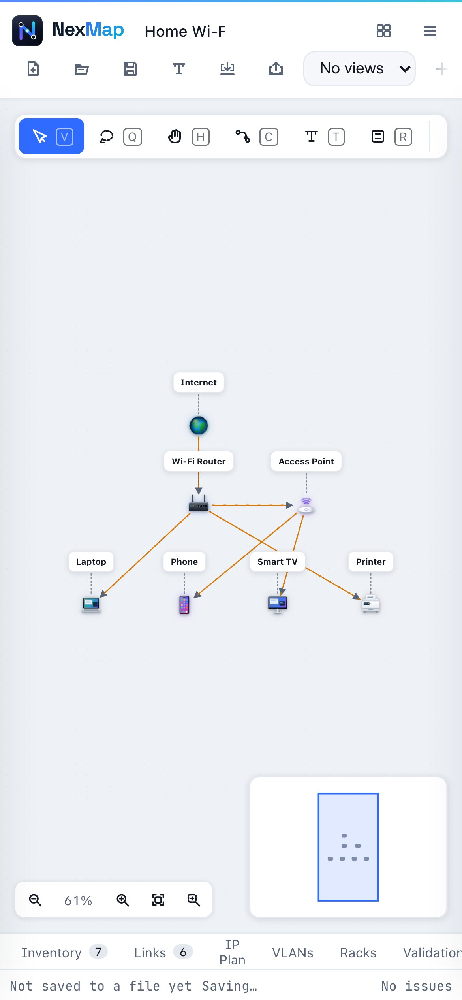

# Frequently asked questions

<b>Is NexMap free?</b>

Yes. NexMap is free and open source under the [MIT license](../../LICENSE).
You can use it for personal or commercial work.

<b>Do I need an account?</b>

No. There's no sign-up and no login. Open [nexmap.xyz](https://nexmap.xyz/)
and start.

<b>Where is my work saved? Can anyone else see it?</b>

Only on your computer: as an autosaved draft in your browser, and in any
`.nexmap` files you save. Nothing is uploaded, and nobody else can see it.
See [Saving, privacy and offline](saving-and-privacy.md).

<b>I closed the tab. Is my work gone?</b>

Almost certainly not. Open NexMap again in the same browser and it offers to
**Recover your work**. To be safe in future, use **Save** to keep a file.

<b>Does it work offline?</b>

Yes. After your first visit, NexMap works without an internet connection. It
tells you when it's ready.

<b>Which browsers does it work in?</b>

Current versions of Chrome, Edge, Firefox and Safari, on desktop, tablet and
phone. Chrome and Edge can save straight back to the same file; the others
download a fresh copy each time you save.

<b>Can I use it on a phone or tablet?</b>

Yes: pinch to zoom, drag with two fingers to move around, and tap to select.
On a phone the toolbar buttons move to their own row, and the canvas tools
scroll sideways. A bigger screen is more comfortable for large designs.

  

<b>I don't know much about networking. Can I still use it?</b>

Yes. Start from one of the home examples, and let NexMap's checks guide you:
every finding explains the problem in plain words and usually offers a fix.
The [glossary](glossary.md) explains the terms.

<b>Can I import my existing diagrams or inventory?</b>

Yes: spreadsheets (CSV), draw.io and GraphML diagrams, Nmap scans and NetBox
exports. See [Import and export](import-export.md).

<b>How do I share a diagram with someone who doesn't use NexMap?</b>

Export it as a PDF or picture, or as **HTML (viewer)**: a single web page
anyone can open and zoom around. To let them edit it, send the `.nexmap` file.

<b>Can two people edit the same project?</b>

Not at the same time; NexMap has no server to sync through. Share the
`.nexmap` file instead. Within one browser, a second tab on the same project
is view-only so the two can't overwrite each other.

<b>I found a bug or have an idea.</b>

Please [open an issue on GitHub](https://github.com/pateldev2511/NexMap/issues).
For a security problem, follow [SECURITY.md](../../SECURITY.md) to report it privately.

