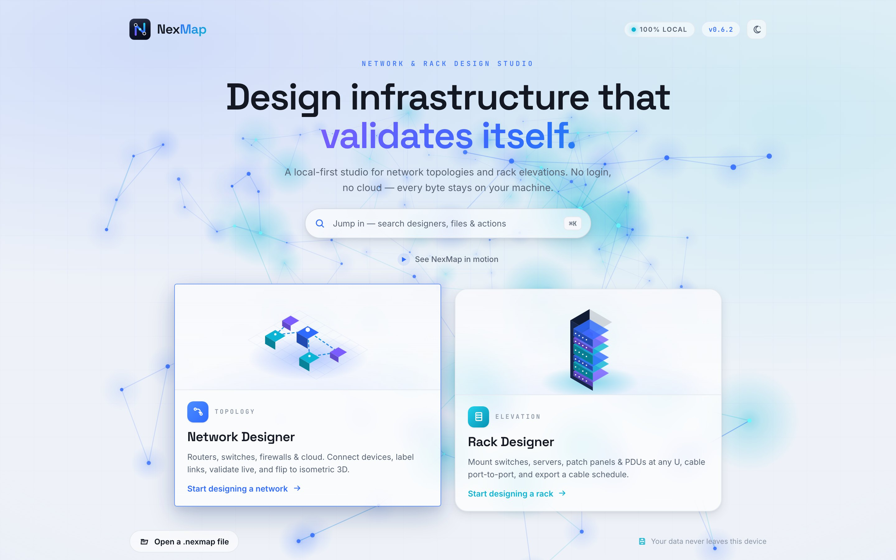
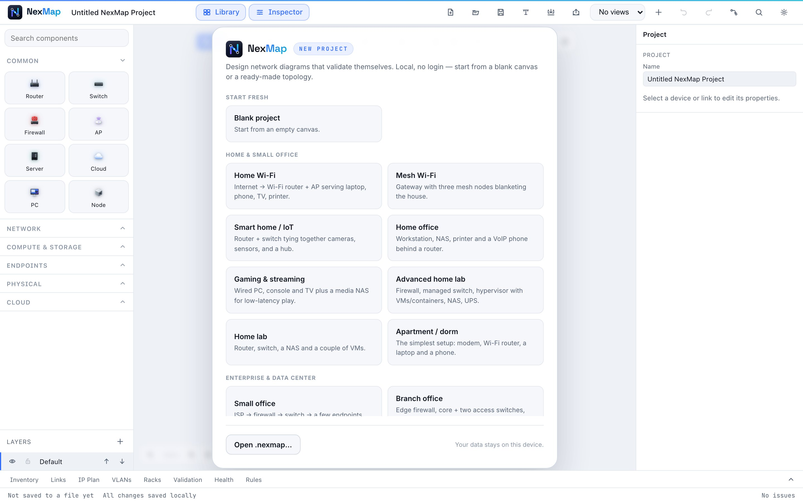
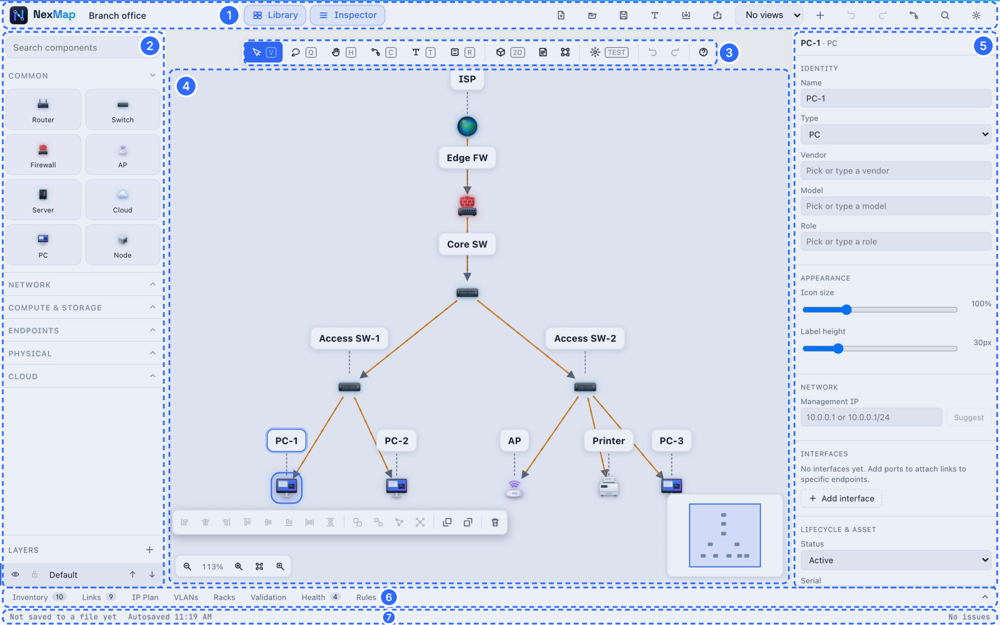
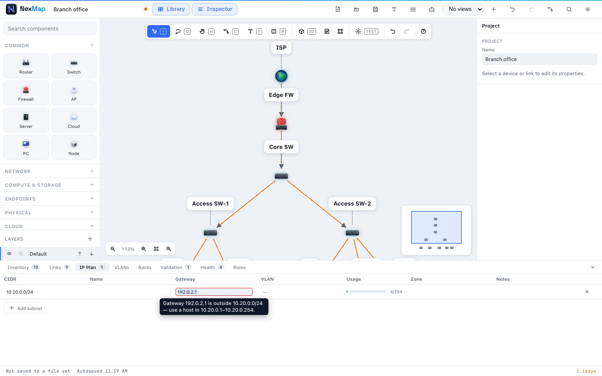

# Getting started

This guide takes you from nothing to a finished, checked network diagram in
about ten minutes. You don't need to know anything about networking: when a
word might be new, there's a link to the [glossary](glossary.md).

## 1. Open NexMap

Go to **[nexmap.xyz](https://nexmap.xyz/)** in Chrome, Edge, Firefox or Safari.
There's nothing to install and no account to create.

You'll see the launch screen with two choices:

  

- **Network Designer**: draw how devices connect to each other. Start here.
- **Rack Designer**: plan which equipment goes where in a server
  [rack](glossary.md#rack). See [The Rack Designer](rack-designer.md).

> [!TIP]
> Press <kbd>Ctrl</kbd>+<kbd>K</kbd> (<kbd>⌘</kbd>+<kbd>K</kbd> on a Mac) on this
> screen to jump straight to anything by typing its name.

## 2. Pick a starting point

Choose **Network Designer**. You'll see a gallery of ready-made examples:

  

- **Blank project** gives you an empty page.
- **Home & small office** examples: Home Wi-Fi, Mesh Wi-Fi, Smart home / IoT,
  Home office, Gaming & streaming, Home lab, Advanced home lab, Apartment / dorm.
- **Enterprise & data center** examples: Small office, Branch office,
  Three-tier campus, DMZ / perimeter, Data center rack, WAN hub & spoke,
  Redundant core (HA), Hybrid cloud, Wireless campus, App tier (3-tier).

Starting from an example close to what you have is the quickest way in: you
can change anything afterwards. For this guide, pick **Home Wi-Fi**.

## 3. Know your way around

  

| | Area | What it's for |
| --- | --- | --- |
| **1** | Top bar | New, Open, Save, Import, Export, undo/redo and more |
| **2** | Library | Every kind of device you can add. Drag one onto the page |
| **3** | Canvas tools | Select, connect, add notes and shapes, switch to 3D, stress-test |
| **4** | Canvas | Your diagram. Scroll or drag to move around, pinch or <kbd>Ctrl</kbd>+scroll to zoom |
| **5** | Inspector | The details of whatever you've selected: name, type, address, notes… |
| **6** | Panels | Tables of your devices, links and addresses, plus Validation, Health and Rules |
| **7** | Status bar | Whether your work is saved, and how many issues NexMap has found |

Panels 2 and 5 can be hidden with the **Library** and **Inspector** buttons at
the top to give your diagram more room.

## 4. Add a device

Find **Printer** in the Library (type "printer" in **Search components** if
you can't see it) and **drag it onto the canvas**.

You can also **double-click any empty spot** on the canvas to pick a device
from a quick menu right where you clicked.

## 5. Connect it

Pick the **Connect** tool on the canvas toolbar (or press <kbd>C</kbd>), then
drag from the router to your new printer. A line appears: that's a
[link](glossary.md#link), a cable or wireless connection.

Press <kbd>V</kbd> to go back to the normal **Select** tool.

## 6. Give it a name and an address

Click the printer. The **Inspector** on the right shows its details:

- **Name**: call it something you'll recognise, like "Office printer".
- **Management IP**: its [IP address](glossary.md#ip-address). Not sure what
  to put? Press **Suggest** and NexMap picks a free one that fits your network.

## 7. Let NexMap check your work

Look at the **status bar** at the bottom right. It says **No issues** when all
is well, or how many it found. Open the **Validation** tab to see them.

Each finding explains the problem in plain words. **Click it** and NexMap
takes you straight to the field to fix:

  

Many findings have a one-click fix button, and **Fix all safe issues** fixes
everything NexMap can fix safely by itself. [Checking your design](checking-your-design.md)
explains every check.

## 8. Save your work

NexMap **autosaves in your browser** about a second after every change, so a
closed tab or a crash won't lose your work: next time you open NexMap it offers
to recover it.

For anything you want to keep, press **Save** (<kbd>Ctrl</kbd>+<kbd>S</kbd>) to
store a `.nexmap` file on your computer. You can open it again any time with
**Open**, on any computer. More in [Saving, privacy and offline](saving-and-privacy.md).

## 9. Share it

Press **Export** (<kbd>Ctrl</kbd>+<kbd>E</kbd>) to make a picture, a PDF, a
web page anyone can open, or a full handoff package. See [Import and export](import-export.md).

## Where next?

- [The Network Designer](network-designer.md): every tool and panel.
- [Checking your design](checking-your-design.md): stress-testing, health and rules.
- [Keyboard shortcuts](shortcuts.md): work faster.
