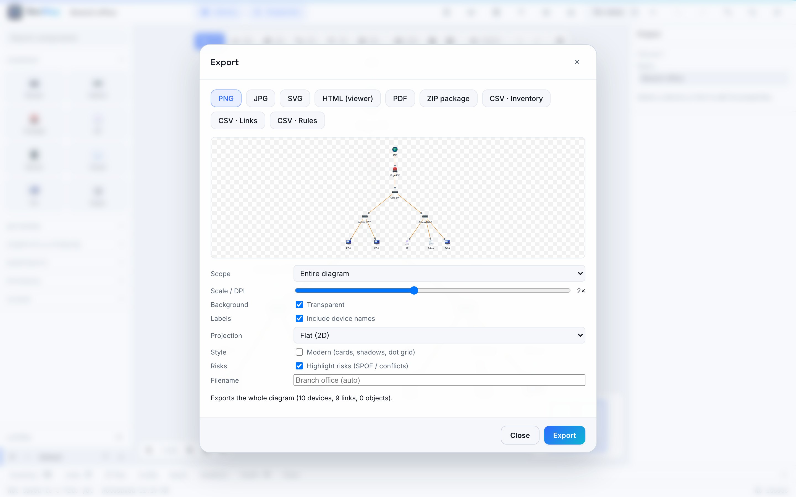

# Import and export

## Importing

Press **Import** in the top bar and choose a file. NexMap shows a **preview**
first: what will be added, and any rows it had to skip and why. Nothing changes
until you confirm, and the whole import can be undone in one step. If a file
can't be read, **Choose another file** lets you try again.

| You have… | NexMap brings in |
| --- | --- |
| **A spreadsheet (CSV)** of devices | Devices with name, type, vendor, model, role, location, address and notes. Match your columns to NexMap's in the preview. |
| **A CSV of connections** | Links between devices you already have, by name. If a name matches two devices, NexMap asks you to rename them rather than guess. |
| **A CSV of subnets or VLANs** | Your IP plan or VLAN list. NexMap recognises it from the column headings. |
| **A draw.io diagram** (uncompressed `.drawio`/`.xml`) | Devices and connections, page by page. |
| **A GraphML file** | Devices and connections. |
| **An Nmap scan** (XML) | Every host that was up, with its address and name. |
| **A NetBox export** (JSON) | Devices with their role, model, vendor, site and address. |
| **A topology JSON file** | Devices and links. |
| **A picture** (PNG, JPG, WebP, GIF or SVG) | A background image to draw over, such as a floor plan. |

Files can be up to 20 MB.

> [!TIP]
> **Paste works too.** Copy rows from a spreadsheet, click the canvas and press
> <kbd>Ctrl</kbd>+<kbd>V</kbd>: they become devices or links. Paste an image
> to use it as a background.

## Exporting

Press **Export** (<kbd>Ctrl</kbd>+<kbd>E</kbd>). Pick a format at the top;
the preview shows exactly what you'll get.

  

| Format | Good for |
| --- | --- |
| **PNG** / **JPG** | A picture for a document, chat or slide |
| **SVG** | A sharp, scalable drawing for designers and print |
| **HTML (viewer)** | A single web page anyone can open and pan or zoom, no NexMap needed |
| **PDF** | Printing or sending a document, with a page of your declared rules |
| **ZIP package** | A complete handoff (see below) |
| **CSV · Inventory** / **CSV · Links** | Device and connection lists for a spreadsheet |
| **CSV · Rules** | Your declared rules, whether each one holds, and what breaks it |

**Options:**

- **Scope**: the whole diagram or just what you've selected.
- **Scale**: how sharp a picture is (higher is sharper and bigger).
- **Background**: transparent or a colour.
- **Labels**: include device names or not.
- **Projection**: flat, 3D isometric, or a blueprint sheet with a title block.
- **Style**: plain, or modern with cards and shadows.
- **Highlight risks**: tint single points of failure and conflicts.
- **Filename**: defaults to your project name.

Very large diagrams are scaled down automatically to stay within what the
browser can draw, and NexMap tells you when it does.

### The ZIP package

Everything about the project in one file, always the whole project:

- `project.nexmap`: the editable project, to open in NexMap
- `diagram.svg`, `diagram.png`, `diagram.pdf`: the picture, exactly as previewed
- `inventory.csv` and `links.csv`: device and connection lists
- `validation-report.txt`: every issue NexMap found
- `rules.csv`: your declared rules, if you have any

For racks, use **Export handoff** in the [Rack Designer](rack-designer.md#hand-it-over-export-handoff).
