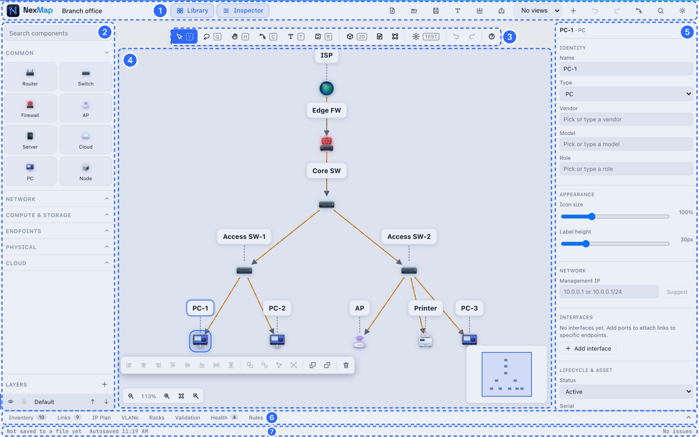
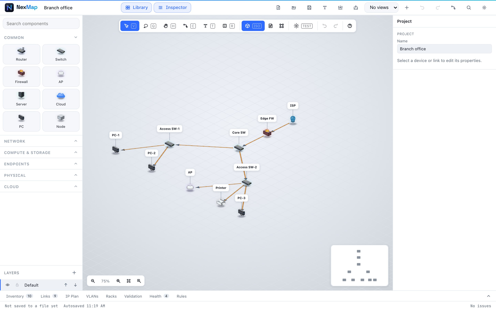

# The Network Designer

The Network Designer is where you draw how your devices connect. This page
walks through every part of the screen. New to NexMap? Start with
[Getting started](getting-started.md).

<p align="center">
  
</p>

## 1 · The top bar

From left to right:

- **Project name.** Click to rename. A small dot next to it means there are
  changes not yet saved to a file.
- **Library** and **Inspector** show or hide the side panels.
- **New** (<kbd>Alt</kbd>+<kbd>N</kbd>) starts a new project. If you have
  unsaved changes, NexMap asks first: **Save**, **Discard changes** or **Cancel**.
- **Open** (<kbd>Ctrl</kbd>+<kbd>O</kbd>) and **Save** (<kbd>Ctrl</kbd>+<kbd>S</kbd>)
  work with `.nexmap` files on your computer.
- **NexText** turns typed text into a diagram (see [below](#nextext-type-a-network)).
- **Import** and **Export**: see [Import and export](import-export.md).
- **Views**: save the current zoom, position and visible layers as a named
  view (**+**), switch between saved views, or delete one (**×**).
- **Undo** and **Redo**.
- **Switch designer** opens the *same project* in the Rack Designer and back,
  keeping your unsaved changes and undo history.
- **Command** (<kbd>Ctrl</kbd>+<kbd>K</kbd>) opens the [command palette](#the-command-palette).
- **More** holds Presentation, Topology outline, Show pages, theme, Settings,
  Keyboard shortcuts and About.

On a narrow window the buttons shrink to icons, and on a phone they move to a
second row. Hover over any icon to see what it does.

## 2 · The Library

Every kind of device you can add, 35 in all, grouped as **Common**,
**Network**, **Compute & Storage**, **Endpoints**, **Physical** and **Cloud**.
Type in **Search components** to find one quickly.

- **Drag** a device onto the canvas to add it.
- Or **double-click empty canvas** to pick one from a quick menu at that spot.

At the bottom, **Layers** let you split a big design into parts (say,
"Wired" and "Wi-Fi"). You can add layers, hide or lock them, and change their order.

## 3 · The canvas tools

| Tool | Key | What it does |
| --- | --- | --- |
| Select | <kbd>V</kbd> | Click to select; drag empty space to select an area |
| Lasso | <kbd>Q</kbd> | Draw around devices to select them |
| Pan | <kbd>H</kbd> | Drag to move around (or hold <kbd>Space</kbd> with any tool) |
| Connect | <kbd>C</kbd> | Drag from one device to another to link them |
| Text note | <kbd>T</kbd> | Add a callout box with a heading and text; it can point at a device |
| Zone / shape | <kbd>R</kbd> | Draw a rectangle or ellipse to group an area (e.g. "Server room") |
| 3D view | | Switch between the flat view and the 3D isometric view |
| Blueprint | | Show the diagram as a technical drawing on blue paper |
| Auto-layout | <kbd>Ctrl</kbd>+<kbd>Shift</kbd>+<kbd>L</kbd> | Tidy up the arrangement automatically |
| TEST | | [Stress-test](checking-your-design.md#stress-test-what-if-something-breaks) your design |

When you select something, a small **selection toolbar** appears next to it
with align, distribute, group, duplicate and delete buttons. Right-click for
more, including **Lock** so a device can't be moved by accident.

## 4 · The canvas

Your diagram lives here.

- **Move around:** scroll, drag with two fingers, hold <kbd>Space</kbd> and
  drag, or use the Pan tool.
- **Zoom:** pinch, or <kbd>Ctrl</kbd>+scroll. The zoom controls in the corner
  include **Fit to screen** (<kbd>Ctrl</kbd>+<kbd>0</kbd>), and
  <kbd>2</kbd> zooms to whatever is selected.
- **Find a device:** <kbd>Ctrl</kbd>+<kbd>F</kbd>, then type its name, address or role.
- **Rename in place:** double-click a device's label.
- The small **minimap** in the corner shows where you are in a big diagram.

<p align="center">
  
</p>

## 5 · The Inspector

Shows and edits whatever you've selected.

**For a device:**

- **Identity:** name, type, hardware model (pick a known model to fill in the
  details), vendor, model and [role](glossary.md#role).
- **Appearance:** icon size and label height.
- **Network:** its management [IP address](glossary.md#ip-address). Press
  **Suggest** for a free one.
- **Interfaces:** its individual [ports](glossary.md#interface-port), each
  with a speed, [VLAN](glossary.md#vlan) and address.
- **Rack placement:** which rack and position it's in (see the
  [Rack Designer](rack-designer.md)).
- **Lifecycle & asset:** status, serial number, asset tag, owner, warranty.
- **Location & notes**, and which [rules](checking-your-design.md#rules-promises-your-design-keeps)
  depend on this device.

**For a link:** its name, type and speed; how the line looks (solid or dashed,
arrows, straight or right-angled, colour, thickness); which port it uses at
each end; and [VLAN / trunk](glossary.md#trunk) settings.

**With nothing selected:** the project's name.

## 6 · The panels

Tabs along the bottom, each with a count:

| Tab | What's in it |
| --- | --- |
| **Inventory** | Every device in a table: name, type, vendor, model, role, location, IP, notes |
| **Links** | Every connection and the ports at each end |
| **IP Plan** | Your [subnets](glossary.md#subnet): address range, name, [gateway](glossary.md#gateway), VLAN and how full each one is |
| **VLANs** | Your [VLANs](glossary.md#vlan) with their numbers and names |
| **Racks** | Your racks, their size, power and weight limits |
| **Validation** | Problems NexMap found, worst first: [Checking your design](checking-your-design.md) |
| **Health** | How resilient the design is, and redundancy between two devices |
| **Rules** | Promises your design keeps, like "no single point of failure" |

Click a row in **Inventory** or **Links** to find that item on the canvas.
**IP Plan**, **VLANs** and **Racks** are edited right in the table: click a
cell to change it, and use the **Add** button below to add a row.

## 7 · The status bar

Shows whether your work is saved to a file, when it was last autosaved, and
how many issues NexMap has found.

## The command palette

Press <kbd>Ctrl</kbd>+<kbd>K</kbd> and type what you want to do. Some examples:

- **"Add router"** or **"Insert: Home Wi-Fi"** to build quickly.
- **"Auto-assign IP addresses"** to address every device.
- **"Scan for single points of failure"** or **"Add a redundant twin"** for resilience.
- **"Toggle 2D / isometric"**, **"Presentation"**, **"Topology outline"**.

You can even type a rule in plain words, such as *"every camera lives in
CCTV"*. NexMap offers to add it as a [rule](checking-your-design.md#rules-promises-your-design-keeps).

## NexText: type a network

**NexText** builds a diagram from simple lines of text: handy if you'd rather
type than drag. One item per line:

```text
# lines starting with # are comments
router R1 vendor=Cisco
switch SW1
pc "Front desk"
R1 - SW1 vlan=10
SW1 -> "Front desk"
subnet 10.0.0.0/24 name=Office gateway=10.0.0.1
vlan 10 name=Users
```

- `type name` adds a device; extra details go after it as `key=value`.
- `A - B` connects two devices (`->` adds an arrow).
- Put quotes around names with spaces.

Mistakes are listed line by line as you type. **Apply** replaces the whole
diagram (NexMap asks first, and you can undo it).

## Notes, zones and pictures

- **Text notes** (<kbd>T</kbd>) can have a heading, subheading, formatted text
  and a coloured pointer line to any device.
- **Zones** (<kbd>R</kbd>) are coloured rectangles or ellipses to mark areas.
- **Pictures:** import or paste an image (a floor plan, say) to draw on top of
  it. Adjust its transparency in the Inspector.

## Presenting

**More → Presentation** shows your diagram full screen, read-only. Nothing
can be changed by accident while you present. Press <kbd>Esc</kbd> to leave.

**More → Topology outline** lists every device and its connections as text:
useful with a screen reader, or to read a big design at a glance.

## Settings

**More → Settings** lets you choose:

- **Theme:** light or dark.
- **Connect behaviour:** click-or-drag, drag only, or click only.
- **Scroll wheel:** pans (default) or zooms.
- **Reduced motion** and **Living motion** (how much the diagram animates).

It also shows what your browser supports and how much storage NexMap uses,
with **Clear all local data…** if you want a fresh start.
