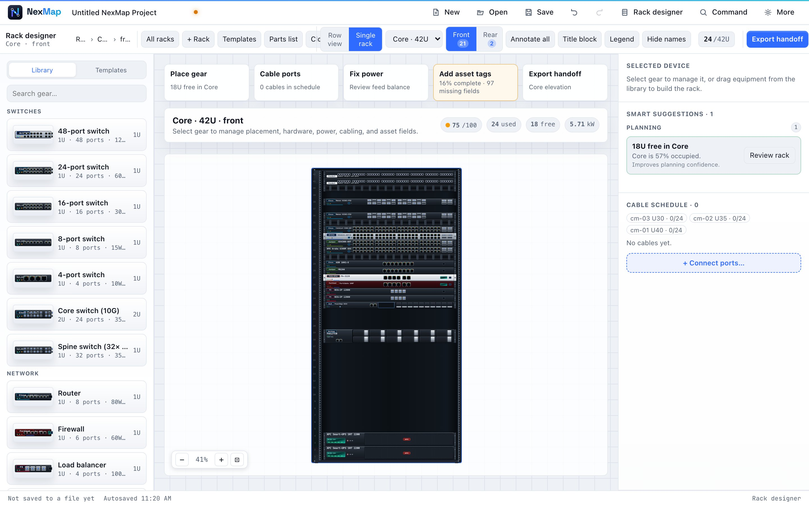
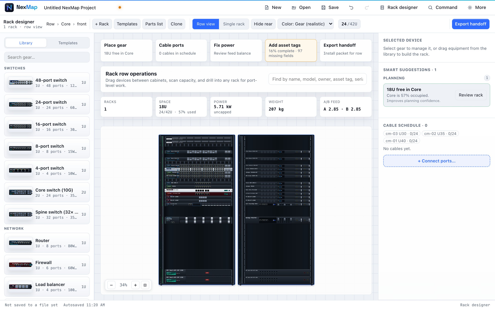

# The Rack Designer

A [rack](glossary.md#rack) is the tall metal cabinet that holds network
equipment: switches, servers, storage, power units. The Rack Designer lets you
plan exactly what goes where, how it's cabled, and whether the power and space
add up, before anyone lifts a screwdriver.

Open it from the launch screen (**Rack Designer**), or press **Switch
designer** in the Network Designer to see the *same project's* racks.

  

## Start with a rack

- **Pick a ready-made rack** from **Templates**: Home lab (6U), Home media +
  NAS (12U), Small office IDF (12U), Office server room (24U), and three
  42U enterprise racks (core, compute and edge).
- Or **+ Rack** to add an empty one, choosing its type: enclosed 42U,
  4-post 24U, server 24U, open 2-post 42U, wall-mount 12U or 6U, or 23-inch 42U.

Racks are measured in **U** ([rack units](glossary.md#u-rack-unit)); one U is
1.75 inches, the height of a thin switch.

## Two ways to look

- **Row view** shows all your racks side by side, like walking down a server
  room aisle. Drag equipment between racks, search across them, show the rear,
  and colour everything by **status**, **owner**, or what happens **if power
  feed A or B fails**. A summary strip adds up space, power and weight.
- **Single rack** shows one rack up close. Flip between **Front** and **Rear**;
  equipment mounted at the back doesn't clash with equipment at the front.

  

## Add equipment

The **Library** on the left has 34 kinds of gear (switches, routers,
firewalls, servers, storage, power units, patch panels, cable managers and
more), each drawn like the real hardware.

- **Click** a piece of gear, then **click a free slot**, or **drag** it in.
  NexMap highlights the slots that fit and warns about clashes.
- Half-width gear can go **left** or **right**, and power strips mount on the
  side rails.
- **Parts list**: paste a quote or parts list as text and NexMap mounts the
  equipment for you, bottom-up, telling you about any lines it didn't recognise.

Select a device to edit its placement, hardware, power, cabling and asset
details on the right. Select several to edit them together, for example to
give them consecutive asset tags.

## Cable it

- **Drag from one port to another**, or click **+ Connect ports…** to pick
  them from a list with a colour, label and length.
- **Patch from topology**: if you've drawn the network in the Network
  Designer, one click cables every connection between racked equipment, using
  the exact ports you named, labelling the cables and estimating their length.
  If a named port is already taken, NexMap tells you instead of guessing.
- **Auto-length** fills in missing cable lengths.

The **cable schedule** on the right lists every cable.

## Power that holds up on the day

Each device can be fed from power **feed A**, **feed B**, or both. NexMap adds
up the load on every power strip ([PDU](glossary.md#pdu)) and
[UPS](glossary.md#ups), and shows what happens **if one feed fails**: which
strips would trip, and which single-corded equipment would go dark. Smart
suggestions point out unbalanced feeds, missing power strips, too few outlets
and strips running past 80% of their rating.

## The health score

The coloured score near the top (for example **75 / 100**) rates the rack on
**capacity**, **redundancy**, **cabling** and **inventory**. Hover over it to
see the biggest risk. **Smart suggestions** on the right list what to fix,
grouped by urgency, and **Fix all safe** applies the safe ones.

## Make it look finished

- **Annotate all** moves device names into a clean column beside the rack.
- **Title block** and **Legend** add a drawing frame and a colour key.
- **Hide names** for a cleaner picture.

## Hand it over: Export handoff

**Export handoff** gathers everything an installer needs. Choose whether it
covers **this rack** or **all racks**:

| Export | What you get |
| --- | --- |
| **Install packet** (PDF or PNG) | The rack drawing plus tables of every cable, power cord and power-strip outlet |
| **Cable schedule** (CSV) | Every cable: from, to, colour, label, length |
| **Power cords** / **Power strips** (CSV) | Which device plugs into which outlet |
| **Bill of materials** (CSV) | A parts list for ordering |
| **Labels** (PNG) | Printable labels |
| **Rack elevation** (PDF or PNG) | The drawing on its own |

Each file is named after what it covers, and a rack export includes cables
that run to other racks, with the far rack named. If an export fails (for
example, a huge drawing the browser can't render), NexMap says why and offers
**Retry**.
